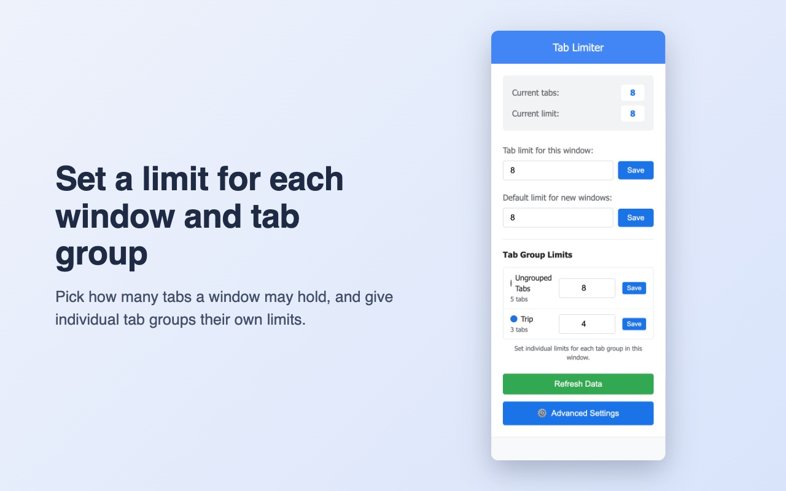
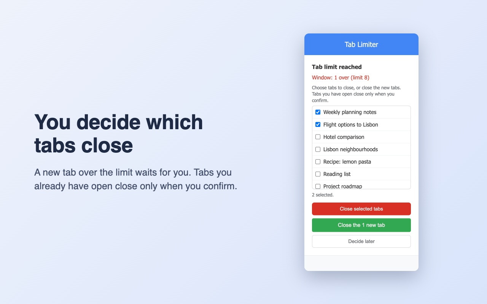

# Tab Limiter

[](https://github.com/CloudyTrees/chrome-tab-limiter/actions/workflows/test.yml)

A Chrome extension that keeps tab overload in check by asking you before it closes tabs you have
open. Set a maximum number of tabs per window, and per tab group inside a window. When a new tab
goes over a limit it stays open and waits, and a popup lets you **choose which tabs to close**.

**One exception:** while a window is waiting for your decision, new tabs beyond the pending limit
(default 5) are closed automatically. Tabs you already have open close only when you confirm.

Everything stays on your device: no network requests, no analytics, no account.

<p>
  
  
</p>

## Features

- **Per-window limits**, with a default for new windows (1 to 100 tabs, default 10). Every tab counts, pinned tabs included.
- **Per-group limits** for each tab group, and for the ungrouped tabs in a window.
- **You decide what closes.** A new tab over a limit is kept as *pending*. The toolbar badge shows how many tabs are over, and the popup opens by itself when Chrome allows it.
- **Safe after a restart.** After a browser start, or when the extension is reloaded or updated, nothing is closed automatically until you make your first decision.
- **Export and import** of your settings (see [what import restores](#export-and-import)).

Only one thing is closed without asking: while a window is waiting for your decision, new tabs
beyond the **pending limit** (default 5, adjustable from 1 to 10 on the options page) are closed
and the popup tells you how many.

## Install

- **Chrome Web Store:** not published yet.
- **From source:** open `chrome://extensions/`, turn on *Developer mode*, click *Load unpacked*
  and select the [`extension/`](extension/) folder. Requires Chrome 127 or later.
- **From a ZIP:** build one with `tools/package.sh`, or use `tools/install.sh` /
  `tools/install.bat`. See [docs/packaging.md](docs/packaging.md).

## Usage

**Set limits.** Click the toolbar icon, enter the maximum for the current window and click *Save*.
To limit a tab group, set its limit in the same popup. Ungrouped tabs have their own limit. Each
group, and the ungrouped tabs, use the default limit unless you override it.

**When a limit is exceeded.** The new tab stays open and the popup lists every tab in the window.

1. Tick the tabs to close and click *Close selected tabs*. The button turns on only when closing
   them would bring every limit back in range, and it never lets you close the last tab in a window.
2. Or click *Close the new tabs* to close only the pending ones.
3. Or click *Decide later*. Nothing changes and nothing times out.

A tab you drag into a window or group that is full counts toward the excess and asks you the same
question, but it is never closed automatically.

**After a browser start.** Restored windows may already be over their limits. Until your first
decision, tabs over a limit are kept and the badge shows the excess. In the popup you can:

- **Keep these** to raise that window's allowance to cover the tabs that were already there. Pending
  tabs and tabs dragged in are not covered, so the window can still be over afterward.
- **Choose tabs to close**, as above.
- **Start enforcing now** to end startup mode in every window without closing or keeping anything.

Your first decision of any kind also ends startup mode.

### Export and import

*Settings* in the popup opens the options page. *Export* downloads a JSON backup. *Import* restores
only the default limit and the pending limit. Window and group limits are **not** restored, and an
import removes the ones you have now. Limits are stored on this device only and are not synced to
your Google account.

The assumptions and known limits, with what has and has not been tested, are in
[CAVEATS.md](CAVEATS.md). Read it before relying on the details above.

## Permissions and privacy

The extension asks for three permissions and no host access:

- **`tabs`**: gives the extension each tab's title and address, which Chrome leaves out of tab data
  otherwise. (A matching host permission or `activeTab` can also expose them; Tab Limiter asks for
  neither, so `tabs` is how it gets them.) It uses titles to show which tab to close, and notices
  that an address changed to detect navigation. Counting tabs and receiving tab events do not need
  it. It is the most sensitive permission because it lets the extension see the address of every
  open tab; nothing is sent anywhere, and titles and addresses are never written to storage.
- **`tabGroups`**: reads group names and colors so groups can have their own limits.
- **`storage`**: saves your limits on this device.

Extension pages cannot make network requests (the content security policy sets `connect-src 'none'`)
and no content scripts are injected. The full policy is in [PRIVACY.md](PRIVACY.md).

## Development

Node.js 22 or later; no npm packages are needed.

```bash
npm test                 # unit tests (Node's built-in runner)
tools/package.sh         # build dist/tab-limiter-<version>.zip from an explicit file list
tools/release.sh         # checked build for a Chrome Web Store upload
```

```
extension/   the extension itself: exactly what ships
tests/       unit tests and an in-memory chrome.* stand-in
tools/       packaging, release and installer scripts, icon sources
store/       Chrome Web Store listing text and screenshots
docs/        development notes, packaging, releasing, design decisions, review history
```

Start with [docs/development.md](docs/development.md) for the architecture, storage layout,
debugging and manual test checklist, and [docs/releasing.md](docs/releasing.md) for publishing.
The design decisions behind the pending and startup behavior are in [docs/decisions.md](docs/decisions.md).

## License and warranty

Released under CC0 1.0 (public domain); see [LICENSE](LICENSE). Use, copy and modify it freely.

It is provided as is, with no warranty of any kind: use it at your own risk. The author uses it
too and takes the same risk. Bug reports and feature requests are welcome in the issue tracker, but
nothing is promised: no support, no response time and no guarantee of fixes.

Built by one person with Claude as a coding assistant. The early planning files from that process
are kept in [docs/archive/](docs/archive/), and the review rounds in [docs/review.md](docs/review.md).
